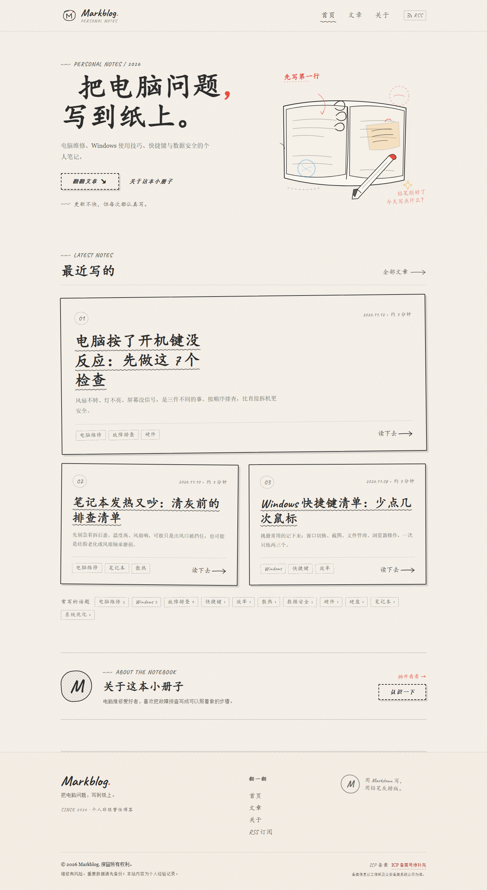
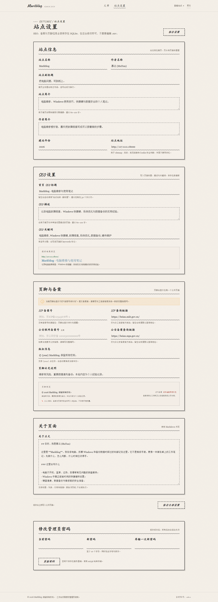

# Markblog

一个铅笔手绘风的中文电脑维修笔记：Vue 3 前端构建成静态文件，由 FastAPI 统一提供页面与 API；文章、SEO、备案信息、页脚和后台会话全部存放在 SQLite 中；正文使用 Markdown 编写。

公开页面**没有任何登录、注册、用户中心入口或相关导航**，也不提供评论、投稿等访客账号功能。唯一的管理员入口位于 `/admin`，不出现在公开页面链接中，并带有 `noindex` 响应头与 robots 屏蔽。

**日常维护只需要后台，不需要修改 `.env`。** SEO 标题、SEO 描述、关键词、ICP 备案号、公安备案号、备案查询链接、站点域名、版权与页脚说明都在「后台 → 站点设置」中维护，保存后写入 SQLite，公开发布。

## 界面预览

| 公开首页 | 后台设置（SEO / 备案） |
| --- | --- |
|  |  |

[查看关于页预览](docs/preview-about.png)

## 默认内容

数据库第一次初始化时会写入 6 篇电脑维修与使用技巧文章：

1. 电脑按了开机键没反应：先做这 7 个检查
2. 笔记本发热又吵：清灰前的排查清单
3. Windows 快捷键清单：少点几次鼠标
4. 电脑变慢先别重装：从任务管理器开始查
5. 蓝屏、死机、自动重启：先记录，再按顺序排查
6. 修电脑前先救数据：备份与硬盘健康检查

文章、标签、摘要和正文都在 SQLite 中，可在后台编辑或删除。删除 `data/markblog.db` 后重启会重新初始化示例内容和默认设置。

## 现在就能运行

在 `markblog` 目录执行：

```powershell
python -m pip install -r requirements.txt
python run.py
```

Windows 也可以直接双击 `start.bat`。

- 公开站点：<http://127.0.0.1:8000/>
- 隐藏管理入口：<http://127.0.0.1:8000/admin>
- 初始管理员账号与密码：本机已有 `.env` 时见其中的 `BLOG_ADMIN_USERNAME`、`BLOG_ADMIN_PASSWORD`。
- 登录后请立刻在「站点设置 → 修改管理员密码」更换密码。

仓库不会提交 `.env`。在新环境部署时，可以将 [`.env.example`](.env.example) 复制为 `.env` 并修改管理员密码；如果直接启动，程序会自动生成随机管理员密码到 `data/initial-admin.txt`。

前端构建产物已经位于 `frontend/dist`，Python 后端会直接托管它。修改前端后重新构建：

```powershell
cd frontend
npm install
npm run build
```

或直接双击 `build-frontend.bat`。

## 数据与设置

以下字段全部保存在 SQLite 的 `settings` 表中，由后台「站点设置」编辑：

| 功能 | 字段 |
| --- | --- |
| SEO | `seo_title`、`seo_description`、`seo_keywords` |
| 备案 | `icp_number`、`icp_link` |
| 公安备案 | `police_number`、`police_link` |
| 站点 | `site_title`、`site_subtitle`、`site_description`、`site_url`、`site_since` |
| 作者与关于 | `author_name`、`author_bio`、`about_md` |
| 页脚 | `copyright`、`footer_note` |

备案查询链接默认指向：

- ICP：<https://beian.miit.gov.cn/>
- 公安备案：<https://beian.mps.gov.cn/>

后台只接受指向工信部、公安备案官方域名的 HTTPS 链接；留空会恢复默认官方地址。公开页脚的备案号只有在填写后才显示为可点击链接，否则显示「ICP 备案号待补充」。

`.env` 只保留启动相关配置：管理员初始账号密码、监听地址、端口和会话时长。**SEO、备案与站点域名不需要改 `.env`**。

`.env` 中的管理员密码只在数据库**第一次**创建管理员时生效；数据库已有管理员后，修改 `.env` 不会覆盖密码。可以用下面的命令重置：

```powershell
python -m backend.manage reset-password
```

## 技术栈

| 层 | 技术 |
| --- | --- |
| 前端 | Vue 3 + Vue Router + Vite，手写 CSS（无 UI 框架） |
| 后端 | Python 3.11+ / FastAPI / Uvicorn |
| 数据 | SQLite（WAL 模式，单文件） |
| 内容 | Markdown（markdown-it-py 渲染） |
| 认证 | 单一管理员，scrypt 密码哈希、数据库会话、HttpOnly Cookie、CSRF Token、登录限流 |

## 已实现内容

### 公开站点

- 首页、文章归档、文章详情、关于、404 页面。
- 页脚在全部公开页面显示版权信息、ICP 备案号、公安备案号及对应的官方查询链接。
- 响应式布局、手绘虚线/波浪线、交叉排线阴影、纸张纹理、标题手写体。
- 支持键盘导航、跳过链接、`prefers-reduced-motion`、移动端菜单。
- 动态 `sitemap.xml`、`robots.txt`、RSS、页面级标题/描述/Open Graph 元信息。
- 首页 SEO 标题、SEO 描述和关键词全部读取数据库；文章页描述来自文章摘要。
- 所有公开 API 只读，不包含任何登录态接口。

### 后台

- `/admin` 管理员账号密码验证；无注册、无找回密码入口、无公开链接。
- 文章新建、编辑、删除、草稿/发布、标签、摘要、Slug、Markdown 实时预览。
- SEO：首页标题、描述、关键词。
- 备案：ICP 备案号与官方查询链接、公安备案号与官方查询链接。
- 站点外观文字、关于页 Markdown、页脚版权、站点地址。
- 修改密码后自动注销全部后台会话。
- 所有写操作需要 CSRF Header；接口不返回密码哈希。
- 后台页面 `noindex`、`X-Robots-Tag: noindex`、`Cache-Control: no-store`。

## 备案前必须完成

技术层面已经按“个人非经营性博客、无访客账号体系”的方向准备，但**备案是否通过由备案服务商与通信管理局审核决定**，本项目不作保证。正式提交前至少确认：

1. 在后台「站点设置 → 页脚与备案」填写与工信部备案系统一致的 **ICP 备案号**。当前为空时，页脚会显示“ICP 备案号待补充”，这不能作为正式备案页面。
2. 如当地要求公安联网备案，填写 **公安联网备案号**；页脚会自动显示对应官方查询链接。
3. 在后台「站点设置 → 站点信息」把站点地址改为真实 HTTPS 域名；后台会用它生成 sitemap、RSS 和规范链接。Cookie 的 `Secure` 标记会根据 HTTPS 请求和数据库中的站点地址自动判断，不需要改环境变量。
4. 检查域名、主体信息、网站名称、服务内容与实际页面一致；替换示例文章中的作者、简介与内容。
5. 确认公开页面只展示博客内容，不出现登录、注册、用户中心、付费、评论、投稿等需要额外资质或专项备案的功能。当前模板没有这些入口。
6. 网站需部署在可访问的中国大陆服务器（若使用大陆备案），并完成接入商核验、公安备案等当地要求。
7. 页脚版权、备案信息在首页、文章页、关于页、404 页均可见；请勿用 CSS 隐藏。
8. 若后续增加评论、会员、投稿或其他互动功能，需要重新评估备案与安全要求。

## 目录结构

```text
markblog/
├─ backend/
│  ├─ app.py            FastAPI 页面、公开 API、隐藏后台 API
│  ├─ auth.py           会话、CSRF、密码策略
│  ├─ config.py         启动参数（.env）
│  ├─ db.py             SQLite 连接、建表、首次初始化
│  ├─ manage.py         重置管理员密码等维护命令
│  ├─ rendering.py      Markdown → 安全 HTML、摘要、阅读时间
│  ├─ repository.py     文章、设置、账号数据访问
│  ├─ schemas.py        请求校验与官方备案链接校验
│  ├─ security.py       scrypt、令牌、登录限流
│  └─ seed_data.py      默认电脑维修文章与数据库默认设置
├─ frontend/
│  ├─ src/
│  │  ├─ admin/         隐藏后台页面
│  │  ├─ components/    页头、页脚、文章卡、手绘装饰
│  │  ├─ views/         首页、文章、关于、404
│  │  ├─ assets/        全局手绘风样式
│  │  └─ lib/           API 状态、会话、SEO、格式化
│  ├─ public/           favicon、OG 图、manifest
│  └─ dist/             已构建的静态站点
├─ data/                 SQLite 数据库（自动创建）
├─ docs/                 界面预览图
├─ tests/                API 自动化测试
├─ .env                  启动参数，勿提交
├─ run.py                启动入口
└─ start.bat             Windows 一键启动
```

## 部署建议

### 1. 启动配置

通常只需要修改 `.env` 中的监听地址、端口，或首次部署时的管理员密码：

```dotenv
BLOG_ADMIN_USERNAME=admin
BLOG_ADMIN_PASSWORD=一个足够长的随机密码
BLOG_HOST=127.0.0.1
BLOG_PORT=8000
BLOG_SESSION_DAYS=7
```

站点地址、SEO 与备案信息在后台设置。修改 `.env` 后重启进程。

### 2. 反向代理

让 Uvicorn 只监听本机，由 Nginx/Caddy 处理 HTTPS。Nginx 示例：

```nginx
server {
    listen 80;
    server_name blog.example.com;
    return 301 https://$host$request_uri;
}

server {
    listen 443 ssl http2;
    server_name blog.example.com;

    ssl_certificate     /path/to/fullchain.pem;
    ssl_certificate_key /path/to/privkey.pem;

    location / {
        proxy_pass http://127.0.0.1:8000;
        proxy_set_header Host $host;
        proxy_set_header X-Forwarded-Proto $scheme;
        proxy_set_header X-Real-IP $remote_addr;
        proxy_set_header X-Forwarded-For $proxy_add_x_forwarded_for;
    }
}
```

`run.py` 默认信任本机代理的 `X-Forwarded-Proto`，用于判断 HTTPS 与 Cookie 安全标记。不要把 `data/`、`.env` 或 `frontend/src` 作为静态目录暴露给外网。

### 3. 进程与备份

- 用 systemd、Windows 服务或其他进程守护工具运行 `python run.py`。
- 建议单进程运行；登录限流保存在进程内存中，多 worker 会变成每个 worker 独立计数。
- 定期备份 `data/markblog.db`。SQLite 使用 WAL，在线备份建议用 `sqlite3` 的 `.backup`，或停服后复制数据库文件。
- `.env` 不要提交到公开仓库。

## 安全设计说明

- 只有一个管理员；没有访客账号表，也没有注册/登录 API 供公开使用。
- 密码使用 `scrypt`，登录接口使用恒定时间比较与按 IP 限流（默认 6 次 / 10 分钟）。
- 会话令牌为随机不透明串，数据库只保存 SHA-256 哈希；Cookie 为 `HttpOnly`、`SameSite=Lax`，HTTPS 下自动加 `Secure`。
- 后台所有写操作要求 `X-CSRF-Token`，前端令牌来自登录/会话接口。
- Markdown 渲染关闭原始 HTML，避免文章内嵌脚本；预览与公开文章使用同一渲染器。
- CSP、`X-Content-Type-Options`、`X-Frame-Options`、Referrer-Policy 等安全响应头默认开启。
- `/admin` 不在 sitemap 中，robots 屏蔽，并带 `noindex` 响应头；公开页面没有任何后台链接。
- 备案查询链接只允许工信部与公安备案官方域名，防止后台误填外部链接。

如果忘记管理员密码，可以在服务器上运行：

```powershell
python -m backend.manage reset-password
```

查看数据库位置与当前管理员账号：

```powershell
python -m backend.manage info
```

## 测试

```powershell
python -m pip install -r requirements-dev.txt
python -m pytest -q
```

测试使用临时数据库，不会修改 `data/markblog.db`。测试覆盖公开站点、6 篇默认文章、登录保护、CSRF、文章 CRUD、Markdown 转义、SEO 字段、备案字段与官方链接校验、密码修改后会话失效。

## 设计说明

视觉采用暖米色纸底 `#f5f0e8`、铅笔灰 `#2c2c2c`、朱红批注、湖蓝链接和少量琥珀高亮；没有纯白、渐变或玻璃模糊。卡片允许轻微倾斜，边框以虚线/波浪线为主，动态反馈控制在 150–200ms。字体使用随包分发的 Caveat 与系统中文字体（KaiTi/宋体回退），不依赖第三方字体 CDN。

## 已知限制

- 本项目是单管理员博客，不包含多用户、评论、点赞、服务端全文搜索、图片上传或对象存储。
- 公开站是 Vue SPA；首屏依赖 JavaScript。后端已为常用路由注入标题、描述、canonical 与 404 状态，静态 HTML 本身不含文章正文。若对 SEO 有更高要求，可进一步接入 SSR/预渲染。
- 备案结果与地区政策有关，需按接入商与管局要求逐项核对。
